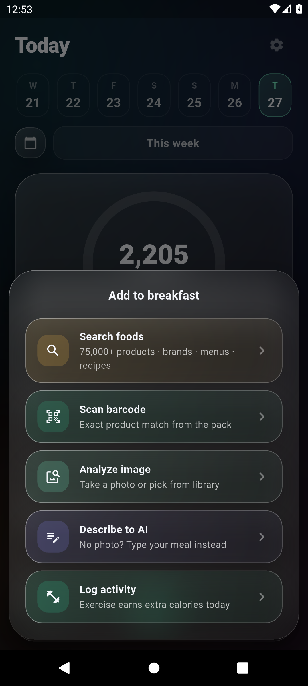
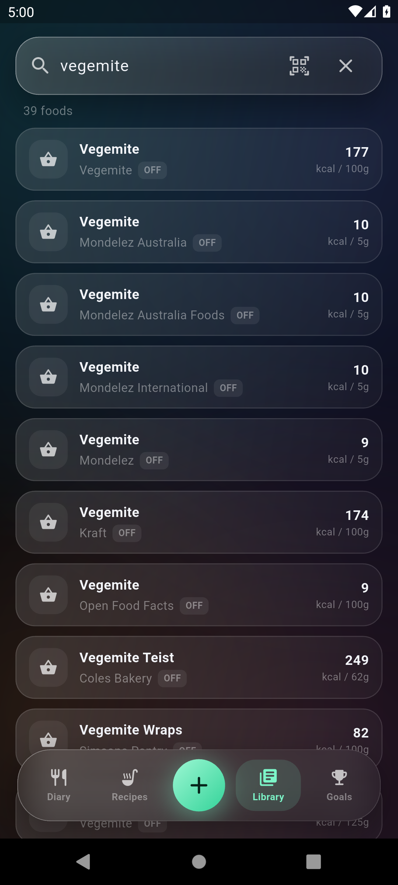
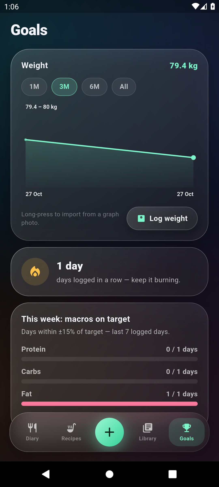
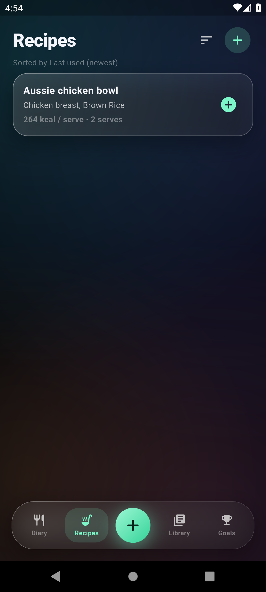
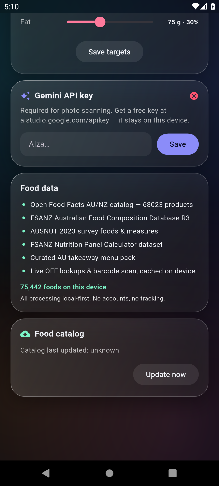

# YourCals 🇦🇺

**Hyper-fast AI calorie tracking, Australian first.**

Snap a photo of your meal, scan a barcode, or read an Aussie nutrition label — YourCals turns it into logged calories and macros in seconds, entirely offline-first on a local database. Built for speed, designed around a liquid-glass dock, and seeded with an Australian & NZ food catalogue.

<p align="center">
  
  
  
  
  
  
</p>

**Diary** · **Capture** · **Aussie food search** · **Goals** · **Recipes** · **Australian data**

More real screens: [onboarding targets](assets/screenshots/07-onboarding-goals.png) · [about you](assets/screenshots/08-onboarding-about.png) · [portion editor](assets/screenshots/09-portion-editor.png) · [recipe editor](assets/screenshots/10-recipe-editor.png) · [full day logged](assets/screenshots/11-diary-full.png)

> Real screenshots captured from the app running on a 1080×2400 Android emulator — no mockups. A full day was logged with genuine Australian data: Weet-Bix, Farmdale (Aldi) milk, Sushi izu, Woolworths salmon and Arnott's Tim Tams.

---

## Point of difference

| | Most calorie trackers | YourCals (Australian / Aussie focused) |
|---|---|---|
| **Food data** | Global database, patchy local coverage | **75,000+ foods on device**: Open Food Facts AU/NZ (68,000+ products), FSANZ Australian Food Composition Database R3, AUSNUT 2023 survey foods & measures, FSANZ Nutrition Panel Calculator dataset, and a curated AU takeaway menu pack |
| **Photo logging** | Manual search & type, or basic AI guess | Gemini vision parses the whole plate: every item, estimated grams from plate/cutlery cues, per-100g nutrition, plus alternatives |
| **Barcode** | Global database, hit-or-miss locally | Scan + **Australian**-first catalogue (Coles, Woolworths, Aldi, IGA, Steggles, Lilydale…) |
| **Label photo** | Type it in yourself | AU/NZ Nutrition Information Panel → per-100g facts (AI fallback when OCR misses it) |
| **Weight history** | Type in each weigh-in | Import weigh-ins from a weight-graph screenshot (Lose It, Apple Health, Renpho, Withings) |
| **Offline** | Cloud-required, slow sync | Local Drift/SQLite database — works with no connection; nutrition snapshotted at log time so history never shifts |
| **Targets** | Fixed daily calorie goal | Mifflin–St Jeor BMR × activity, adjusted by goal rate; adapts to every weigh-in, no hard 1200 kcal clamp |
| **Recipes** | Rare, clunky | Recipe builder with per-serving nutrition, nested recipe references, and g/ml/serv/tsp/tbsp/cup/oz serving units |
| **Privacy** | Accounts, tracking, cloud sync | No accounts, no tracking — all processing local-first |
| **UI** | Standard lists | Deep-space canvas + aurora glass + liquid-glass dock (Diary · Recipes · Library · Goals + capture) |

---

## Features

- **Photo AI** — Take a meal photo; Gemini identifies every item, estimates portions, returns per-100g macros and confidence. Self-healing model selection (auto-discovers the newest flash model when one retires).
- **Text logging** — Describe a meal in words, get itemised nutrition.
- **Barcode scanner** — `mobile_scanner` for packaged foods, matched against the **Australian** catalogue first, with manual barcode-digit entry when there's no camera.
- **Nutrition label import** — Photo of an AU/NZ NIP panel → product, brand, serving size, per-100g macros.
- **Weight-graph import** — AI extracts dated weigh-ins from a screenshot; weekly medians smooth day-to-day noise.
- **Diary** — Log by day & meal (breakfast/lunch/dinner/snacks), undoable edits, serves/grams/ml, live energy ring and macro bars.
- **Goals** — Profile (sex, age, height, weight, activity, lose/maintain/gain), weekly rate, macro splits, custom kcal target. Targets follow your latest weigh-in.
- **Recipes** — Build multi-ingredient recipes, per-serving nutrition, nested recipe references.
- **Library** — Searchable food catalogue with favourites, history, brands and barcodes — Aussie & NZ products first.
- **Settings** — Daily targets with macro sliders, TDEE recalculation, Gemini API key, model preference, and on-device dataset stats.

---

## Tech stack

- **Framework:** Flutter (Material 3)
- **State:** `flutter_riverpod`
- **Database:** Drift / SQLite (local, offline-first) via `sqlite3_flutter_libs`
- **AI:** Google Gemini REST (`dio`) — meal photos, text, weight graphs, NIP labels; strict JSON schemas
- **Vision/Input:** `google_mlkit_text_recognition`, `image_picker`, `mobile_scanner`, `flutter_image_compress`
- **UX:** `flutter_animate`, custom glass/aurora design system (`core/theme.dart`, `core/glass.dart`)
- **Local storage:** `flutter_secure_storage`, `shared_preferences`
- **Codegen:** `build_runner`, `drift_dev`, `flutter_launcher_icons`

---

## Getting started

```bash
# 1. Get Flutter (sdk ^3.12.2)
flutter --version

# 2. Install dependencies
flutter pub get

# 3. Add your Gemini API key in the app (Settings screen) —
#    the app self-discovers a compatible flash model from your key.

# 4. Run
flutter run
```

### Generate platform assets
```bash
# App icon (see pubspec.yaml flutter_launcher_icons config)
flutter pub run flutter_launcher_icons

# Drift database tables (after editing lib/data/db/tables.dart)
flutter pub run build_runner build --delete-conflicting-outputs
```

### Folder tour
```
lib/
  app.dart           # Boot gate: splash → onboarding → root shell
  core/              # theme, glass, aurora, formatting, fx
  data/              # repositories, drift db, Gemini client, search, seed
  domain/            # Food, LogEntry, Recipe, Profile, Weight, Activity, Nutriments
  state/             # Riverpod providers & controllers
  ui/                # Diary, Recipes, Library, Goals, Capture, Barcode, Photo, Onboarding, Settings
assets/
  screenshots/       # real screenshots captured on a 1080×2400 Android emulator
  seed/              # Australian & NZ food catalogue (seed_foods.json, catalog_off.json, activities.json)
```

---

<sub>YourCals — log fast, stay Aussie. Built with Flutter + Gemini.</sub>
