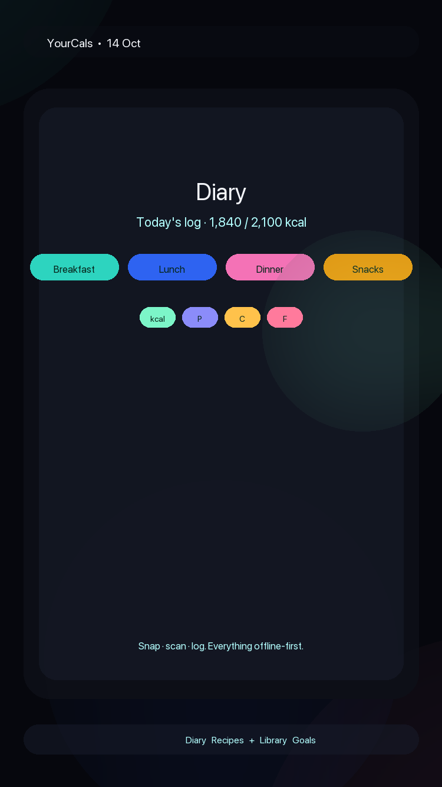
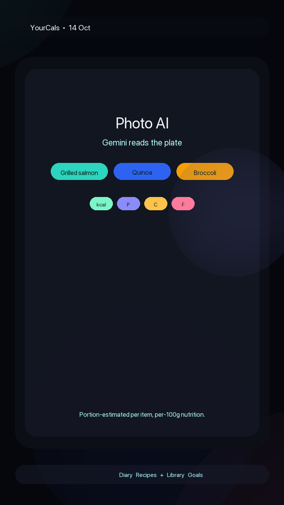
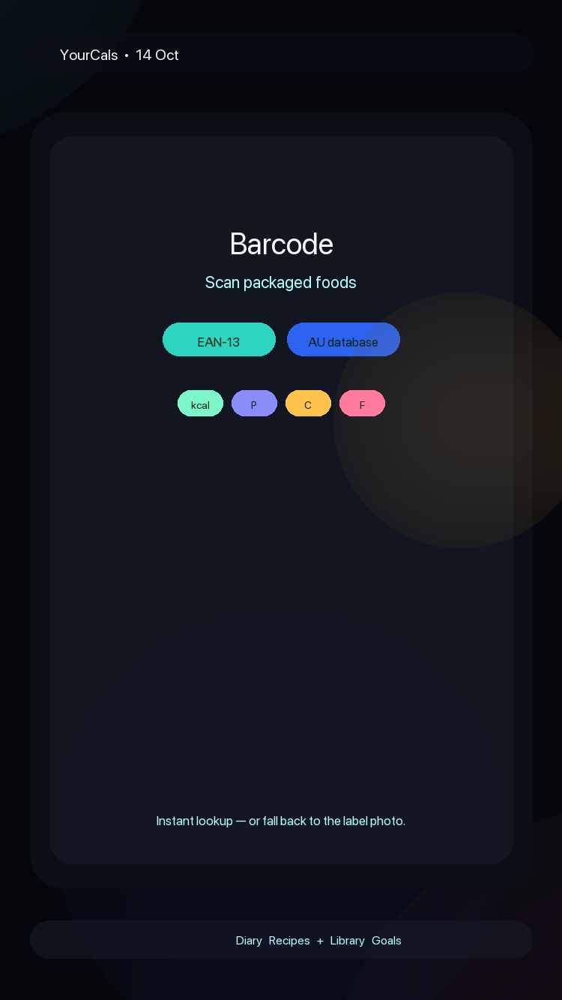
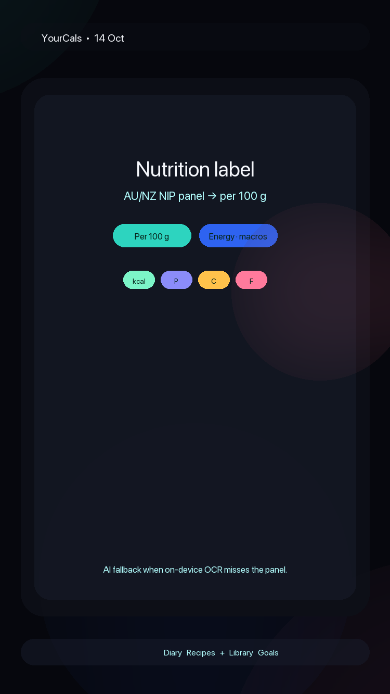
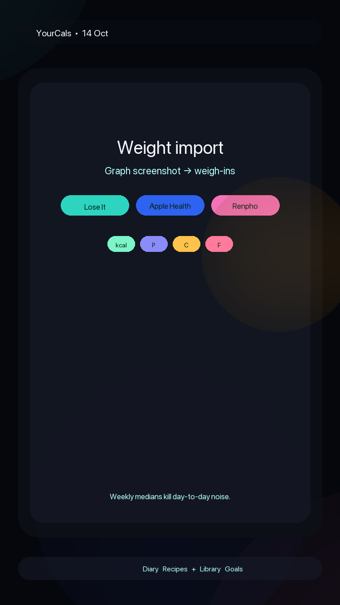
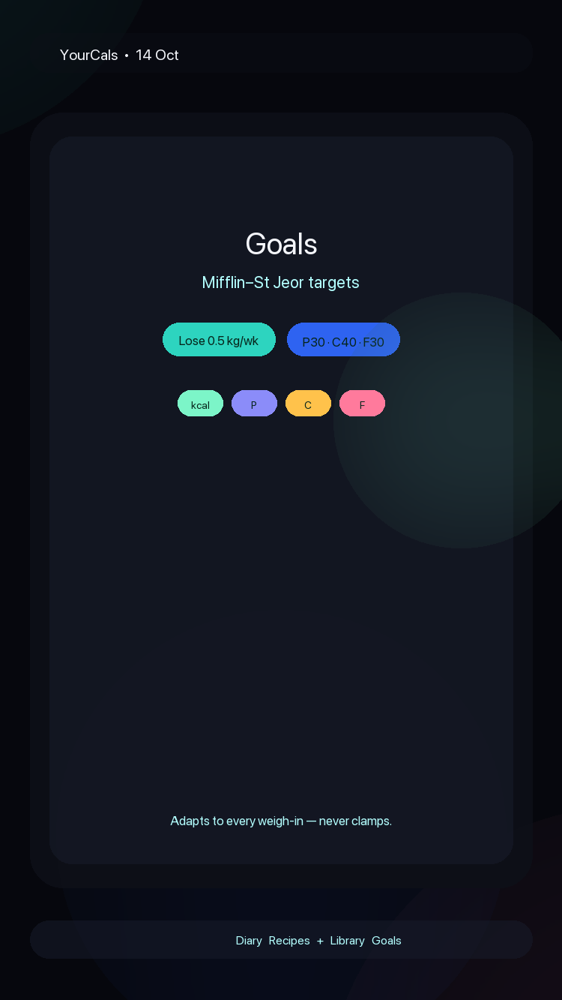
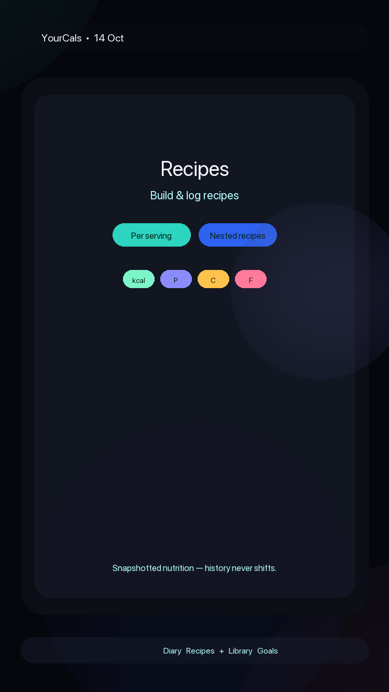

# YourCals

**Hyper-fast AI calorie tracking, Australia first.**

Snap a photo of your meal, scan a barcode, or read a nutrition label — YourCals turns it into logged calories and macros in seconds, entirely offline-first on a local database. Built for speed, designed around a liquid-glass dock, and seeded with an Australian food catalogue.

<p align="center">
  
  
  
  
  
  
  
</p>

> These are placeholder screenshots. Replace `assets/screenshots/*.png` with real device captures before release.

---

## Point of difference

| | Most calorie trackers | YourCals |
|---|---|---|
| **Photo logging** | Manual search & type, or basic AI guess | Gemini vision parses the whole plate: every item, estimated grams from plate/cutlery cues, per-100g nutrition, plus alternatives |
| **Barcode** | Global database, hit-or-miss locally | Scan + Australian-first seed catalogue |
| **Label photo** | Type it in yourself | AU/NZ Nutrition Information Panel → per-100g facts (AI fallback when OCR misses it) |
| **Weight history** | Type in each weigh-in | Import weigh-ins from a weight-graph screenshot (Lose It, Apple Health, Renpho, Withings) |
| **Offline** | Cloud-required, slow sync | Local Drift/SQLite database — works with no connection; nutrition snapshotted at log time so history never shifts |
| **Targets** | Fixed daily calorie goal | Mifflin–St Jeor BMR × activity, adjusted by goal rate; adapts to every weigh-in, no hard 1200 kcal clamp |
| **Recipes** | Rare, clunky | Recipe builder with per-serving nutrition and nested recipe references |
| **Units** | Grams only | g / ml / serves, liquids default to ml |
| **UI** | Standard lists | Deep-space canvas + aurora glass + liquid-glass dock (Diary · Recipes · Library · Goals + capture) |

---

## Features

- **Photo AI** — Take a meal photo; Gemini identifies every item, estimates portions, returns per-100g macros and confidence. Self-healing model selection (auto-discovers the newest flash model when one retires).
- **Text logging** — Describe a meal in words, get itemised nutrition.
- **Barcode scanner** — `mobile_scanner` for packaged foods.
- **Nutrition label import** — Photo of an AU/NZ NIP panel → product, brand, serving size, per-100g macros.
- **Weight-graph import** — AI extracts dated weigh-ins from a screenshot; weekly medians smooth day-to-day noise.
- **Diary** — Log by day & meal (breakfast/lunch/dinner/snacks), undoable edits, serves/grams/ml.
- **Goals** — Profile (sex, age, height, weight, activity, lose/maintain/gain), weekly rate, macro splits, custom kcal target. Targets follow your latest weigh-in.
- **Recipes** — Build multi-ingredient recipes, per-serving nutrition, nested recipe references.
- **Library** — Searchable food catalogue with favourites, brands, barcodes.
- **Settings** — Gemini API key, model preference (auto or pinned), model discovery list live from your key.

---

## Tech stack

- **Framework:** Flutter (Material 3)
- **State:** `flutter_riverpod`
- **Database:** Drift / SQLite (local, offline-first) via `sqlite3_flutter_libs`
- **AI:** Google Gemini REST (`dio`) — meal photos, text, weight graphs, NIP labels; strict JSON schemas
- **Vision/Input:** `google_mlkit_text_recognition`, `image_picker`, `mobile_scanner`, `flutter_image_compress`
- **UX:** `flutter_animate`, custom glass/aurora design system (`core/theme.dart`, `core/glass.dart`)
- **Local storage:** `flutter_secure_storage`, `shared_preferences`
- **Codegen:** `build_runner`, `drift_dev`, `flutter_launcher_icons`

---

## Getting started

```bash
# 1. Get Flutter
flutter --version   # requires sdk ^3.12.2

# 2. Install dependencies
flutter pub get

# 3. Add your Gemini API key in the app (Settings screen) —
#    the app self-discovers a compatible flash model from your key.

# 4. Run
flutter run
```

### Generate platform assets
```bash
# App icon (see pubspec.yaml flutter_launcher_icons config)
flutter pub run flutter_launcher_icons

# Drift database tables (after editing lib/data/db/tables.dart)
flutter pub run build_runner build --delete-conflicting-outputs
```

### Folder tour
```
lib/
  app.dart           # Boot gate: splash → onboarding → root shell
  core/              # theme, glass, aurora, formatting, fx
  data/              # repositories, drift db, Gemini client, search, seed
  domain/            # Food, LogEntry, Recipe, Profile, Weight, Activity, Nutriments
  state/             # Riverpod providers & controllers
  ui/                # Diary, Recipes, Library, Goals, Capture, Barcode, Photo, Onboarding, Settings
assets/
  screenshots/       # replace placeholders with real device captures
  seed/              # Australian food catalogue (seed_foods.json, catalog_off.json, activities.json)
```

---

## Roadmap / notes

- Version `1.1.0+2`. SDK constraint `^3.12.2`.
- Minimum Android SDK 24; iOS enabled.
- `publish_to: 'none'` — this is an app, not a pub package.

---

<sub>YourCals — log fast, stay Australian. Built with Flutter + Gemini.</sub>
